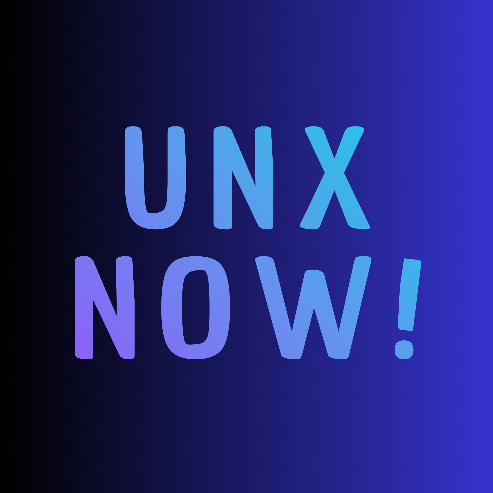

# UNXNOW Cookie Manager

<div align="center">
  
  <h3>Modern, Lightweight & Secure Cookie Manager for Chromium Browsers</h3>

  [](#)
  [](#)
  [](#)
  [](#)
</div>

---

## 🌟 Tentang Ekstensi

**UNXNOW Cookie Manager** adalah ekstensi browser modern berbasis **Manifest V3** yang dirancang untuk mengelola, mengedit, mengorganisasi, serta mencadangkan cookie dengan cepat, aman, dan tanpa lag. Ekstensi ini mendukung alur kerja *multi-account* dengan navigasi bertingkat, penataan kategori kustom, serta antarmuka visual yang estetik dengan tema Terang dan Gelap.

---

## 🚀 Fitur Unggulan

### 1. 🍪 Editor Cookie Lengkap & Real-Time
- **Inspeksi Langsung**: Lihat semua cookie tab aktif lengkap dengan atribut `Name`, `Value`, `Domain`, `Path`, `Expiration Date`, `SameSite` (Lax, Strict, None), `Secure`, `HttpOnly`, dan `Session`.
- **Edit & Buat Cookie**: Ubah nilai atau tambahkan cookie baru langsung dengan validasi otomatis.
- **Hapus Selektif & Bersih**: Hapus satu cookie spesifik atau bersihkan seluruh cookie domain dengan satu klik.

### 2. 📂 Direktori Website Bertingkat & Profil Multi-Akun
- **Website Tersimpan**: Simpan state cookie untuk website favorit Anda (misal: beberapa akun kerja, personal, atau akun pengujian).
- **Penerapan Instan (*Launch*)**: Terapkan profil cookie yang tersimpan langsung ke browser hanya dengan satu klik.
- **Drag & Drop Reordering**: Ubah urutan website dan cookie dengan mudah melalui antarmuka drag-and-drop interaktif.

### 3. 🏷️ Pengelompokan Kategori Kustom
- **Organisasi Fleksibel**: Buat, edit, urutkan, dan hapus kategori kustom (contoh: `#Sosial`, `#Kerja`, `#Finance`, `#Hiburan`).
- **Filter Cepat**: Bilah chip kategori di bagian atas memungkinkan pemfilteran website secara instan.
- **Dropdown Pemilih Kategori Modern**: Dialog edit website dilengkapi pemilih kategori kustom dengan indikator status aktif dan akses cepat ke pengaturan kategori.

### 4. 💾 Cadangkan & Pulihkan (Backup & Restore)
- **Ekspor JSON**: Cadangkan seluruh website tersimpan, profil akun, catatan, dan kategori ke satu file JSON.
- **Pulihkan Seketika**: Pindahkan konfigurasi dan profil cookie Anda ke PC lain tanpa repot.

### 5. 🎨 Desain Modern & UI Halus
- **Mode Terang & Gelap**: Didesain dengan palet warna Slate/Sky beresolusi tinggi, bebas flicker, dan nyaman di mata.
- **Bilingual (Dua Bahasa)**: Dukungan Bahasa Indonesia dan English yang dapat diganti secara langsung dari menu pengaturan.

---

## 📥 Panduan Pemasangan (Instalasi)

### Cara 1: Menggunakan Folder (Load Unpacked - Direkomendasikan)
1. Unduh atau clone repositori ini ke komputer Anda.
2. Buka browser (Google Chrome, Microsoft Edge, atau Brave).
3. Masuk ke halaman pengelolaan ekstensi:
   - **Chrome**: `chrome://extensions`
   - **Edge**: `edge://extensions`
4. Aktifkan toggle **Developer mode (Mode pengembang)** di pojok kanan atas.
5. Klik tombol **Load unpacked (Muat yang belum dibongkar)** di pojok kiri atas.
6. Pilih folder **`Unxnow`** (folder yang berisi file `manifest.json`).
7. Selesai! Sematkan (*pin*) icon UNXNOW ke toolbar browser Anda.

### Cara 2: Menggunakan File Paket (`.crx`)
1. Di halaman `chrome://extensions` dengan *Developer mode* aktif.
2. Seret (*drag and drop*) file **`Unxnow.crx`** langsung ke jendela browser.
3. Klik tombol konfirmasi **Add extension**.

---

## 📁 Struktur Proyek

```text
cookie-edit/
├── Unxnow/                       # Folder utama ekstensi (siap muat di browser)
│   ├── manifest.json             # Konfigurasi Manifest V3 ekstensi
│   ├── background.js             # Service worker untuk event listener cookies
│   ├── popup.html                # Struktur antarmuka popup ekstensi
│   ├── popup.css                 # Desain sistem & styling (Light & Dark theme)
│   ├── popup.js                  # Logika interaktif antarmuka popup
│   ├── core/                     # Modul logika modular
│   │   ├── cookie-manager.js     # API wrapper untuk chrome.cookies
│   │   ├── preset-manager.js     # Pengelola storage profil & kategori
│   │   ├── formatters.js         # Utilitas pemformat format JSON/Netscape
│   │   └── i18n.js               # Manajemen lokalisasi (ID / EN)
│   └── icons/                    # Aset logo dan icon berbagai resolusi
│       ├── logo.png              # Master logo beresolusi tinggi (2000x2000)
│       ├── logo-16.png           # Icon favicon / menu (16x16)
│       ├── logo-32.png           # Icon toolbar browser (32x32)
│       ├── logo-48.png           # Icon halaman chrome://extensions (48x48)
│       └── logo-128.png          # Icon instalasi & Web Store (128x128)
├── Unxnow-Cookie-Manager.zip     # Arsip paket bersih untuk dibagikan ke PC lain
└── README.md                     # Dokumentasi proyek
```

---

## 🔒 Izin Ekstensi (`permissions`)

| Izin | Alasan Penggunaan |
| :--- | :--- |
| `cookies` | Membaca, menulis, memperbarui, dan menghapus cookie pada tab aktif. |
| `tabs` | Mengambil URL dan domain dari tab browser yang sedang aktif. |
| `storage` | Menyimpan profil cookie, website tersimpan, preferensi tema, dan kategori secara lokal di `chrome.storage.local`. |
| `<all_urls>` | Memungkinkan pengelolaan cookie pada semua domain website yang diakses pengguna. |

---

## 🛠️ Pengembangan & Pengujian

Ekstensi ini dibangun menggunakan JavaScript murni (ES Modules) tanpa ketergantungan runtime eksternal.

- **Validasi Sintaksis JS**:
  ```bash
  node --check Unxnow/popup.js
  node --check Unxnow/background.js
  node --check Unxnow/core/preset-manager.js
  node --check Unxnow/core/i18n.js
  ```
- **Menjalankan Uji Coba Kategori**:
  ```bash
  node scratch/test_categories.mjs
  ```

---

## 👤 Pengembang & Hak Cipta

- **Pengembang**: [@Unxnow0712](https://github.com/Unxnow0712)
- **Versi**: `1.2.0`
- **Lisensi**: MIT License
